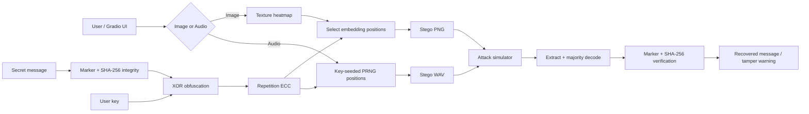

# StegoLab — Image & Audio Steganography

[](https://github.com/mishal913/steganography-image-audio/actions/workflows/ci.yml)


An interactive Python/Gradio laboratory for experimenting with **image and WAV audio steganography**, integrity checking, error-correction coding, simulated tampering, and embedding-safety analysis.

> **Important:** this is an educational steganography project. The XOR step is lightweight obfuscation, not modern cryptographic encryption. Do not use this application to protect real sensitive or regulated data.

## Recruiter quick scan

| Area | Implementation |
|---|---|
| Image steganography | Texture-aware LSB embedding using a gradient-derived heatmap |
| Audio steganography | Key-seeded pseudo-random LSB embedding in PCM WAV samples |
| Robustness | Repetition-code ECC with majority-vote decoding |
| Integrity | SHA-256 message hash + format marker |
| Quality metrics | PSNR for images, SNR for audio |
| Adversarial simulation | Noise, crop/resize, quantization, pixel/sample tampering, trim/pad |
| Audio analysis | RMS + zero-crossing activity scoring and safe-segment ranking |
| Interface | Multi-tab Gradio application |
| Engineering | Tests, Dockerfile, CI, dependency automation |

## Features

### Image steganography

- 1 or 2 least-significant bits per RGB channel
- image texture/gradient heatmap used to prioritize higher-activity pixels
- spread payload placement across selected pixels
- configurable repetition-code error correction
- keyed payload obfuscation
- SHA-256 integrity verification
- PSNR reporting
- cover-vs-stego change map
- simulated Eve attacks:
  - additive noise
  - crop + resize
  - JPEG-like quantization
  - random pixel LSB tampering

### Audio steganography

- 16-bit WAV processing
- 1 or 2 embedded bits per sample
- SHA-256-derived PRNG seed for key-dependent embedding positions
- configurable repetition-code ECC
- SNR reporting
- simulated attacks:
  - additive noise
  - quantization
  - trim + pad
  - random sample LSB tampering

### Audio safety analysis

The analysis view computes local activity from:

- RMS energy
- zero-crossing behavior

It produces an activity heatbar and ranks high-activity audio segments as preferred experimental embedding regions.

## Architecture



## How the image pipeline works

1. Convert the cover image to RGB and resize it for the experiment.
2. Compute a simple Sobel-like gradient magnitude map.
3. Rank pixels by visual activity.
4. Build a payload containing a format marker, message, and SHA-256 digest.
5. Obfuscate the payload with the supplied key.
6. Convert it to bits and optionally repeat each bit for error correction.
7. Embed header bits and payload bits in selected LSB positions.
8. During recovery, decode repeated bits by majority vote and verify the marker/hash.

## How the audio pipeline works

1. Read 16-bit PCM WAV samples.
2. Derive a deterministic PRNG seed from the supplied key.
3. Permute sample positions using that seed.
4. Embed the ECC-encoded bitstream in the selected least-significant sample bits.
5. Recover using the same key-dependent ordering.
6. Validate the recovered payload with its marker and SHA-256 digest.

## Run locally

Create an environment and install dependencies:

```bash
python -m venv .venv
```

Activate it, then:

```bash
pip install -r requirements.txt
python app.py
```

Open the Gradio URL printed in the terminal.

## Run with Docker

```bash
docker build -t stegolab .
docker run --rm -p 7860:7860 stegolab
```

Then open:

```text
http://localhost:7860
```

## Tests

```bash
pip install pytest
pytest -q
```

The test suite covers payload round-tripping, wrong-key detection, ECC behavior, deterministic keyed ordering, and basic metric behavior.

## Project structure

```text
steganography-image-audio/
├── app.py
├── requirements.txt
├── tests/
│   └── test_core.py
├── SECURITY.md
├── Dockerfile
├── .github/
│   ├── workflows/ci.yml
│   └── dependabot.yml
└── README.md
```

## Engineering notes

This project intentionally exposes the difference between **steganography**, **integrity checking**, and **encryption**:

- steganography hides the existence/location of a message
- SHA-256 detects accidental or adversarial modification of the recovered payload
- the implemented XOR step only obfuscates bytes and is **not secure encryption**

A production security design should use authenticated encryption such as AES-GCM or ChaCha20-Poly1305 and an appropriate key-derivation function.

## Future improvements

- authenticated encryption
- stronger forward-error-correction codes
- capacity/imperceptibility optimization
- real codec robustness testing
- automated BER measurement under attacks
- spectrogram-aware audio embedding
- additional image quality metrics such as SSIM
